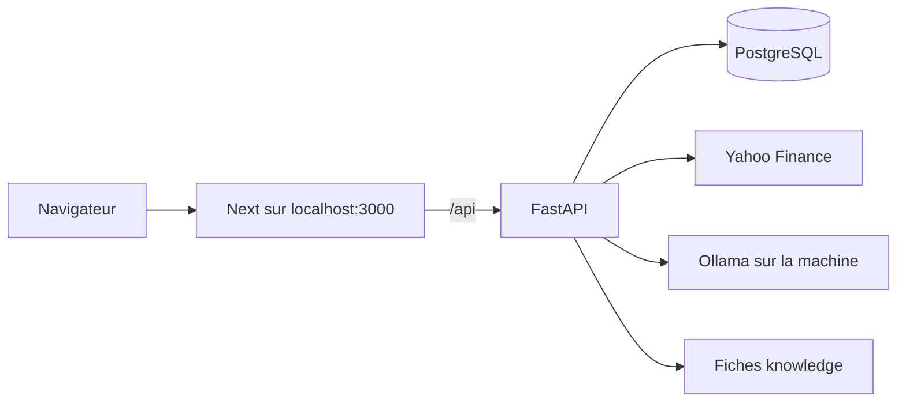

# MarketPulse

Lecture de marché pour un projet universitaire. Les cours viennent de Yahoo Finance. Aucun prix n'est inventé. Les textes sont pédagogiques : ce n'est pas un conseil en investissement.



Le frontend est ce dépôt. L'API FastAPI et PostgreSQL sont dans le dossier voisin `C:\Users\yakin\finsight`.

## Lancer le projet

Deux terminaux PowerShell. Docker Desktop doit être démarré. Le port 8000 doit être libre : un uvicorn lancé à la main sur ce port empêche le conteneur de démarrer.

**1. Base et API**

```powershell
cd C:\Users\yakin\finsight
copy .env.example .env
docker compose up -d --build
```

Vérifier : http://127.0.0.1:8000/health doit répondre `{"status":"ok","service":"marketpulse"}`.

Ollama reste sur la machine, pas dans Docker. L'API le joint via `host.docker.internal`. Sans Ollama, les avis restent le texte calculé en Python.

```powershell
ollama pull llama3.2:3b
```

**2. Interface**

```powershell
cd C:\Users\yakin\marketpulse
copy .env.example .env.local
npm install
npm run dev
```

Ouvrir http://localhost:3000.

Le service worker est désactivé pendant `npm run dev`. Pour tester la PWA : `npm run build` puis `npm start`.

## Variables

| Variable | Où | Rôle |
| --- | --- | --- |
| `POSTGRES_PASSWORD` | `finsight/.env` | Mot de passe du Postgres Docker. Le volume déjà créé utilise `monmdp`. |
| `DATABASE_URL` | `finsight/.env` | Connexion pour un uvicorn lancé sur la machine. Schéma obligatoire : `postgresql+psycopg://`. |
| `OLLAMA_URL` | `finsight/.env` | Défaut Docker : `http://host.docker.internal:11434`. |
| `OLLAMA_MODEL` | `finsight/.env` | `llama3.2:3b`. |
| `MARKET_REFRESH_ON_START` | `finsight/.env` | `1` rafraîchit Yahoo au démarrage si besoin. `0` coupe le réseau. |
| `NEXT_PUBLIC_API_URL` | `marketpulse/.env.local` | `/api`. Next relaie vers `http://127.0.0.1:8000` (`API_PROXY_TARGET` si l'API n'est pas là). |

Le conteneur API ne lit pas `DATABASE_URL` du fichier `.env` : `docker-compose.yml` le fixe vers l'hôte `db`, avec le driver `psycopg`.

## Arrêter

```powershell
cd C:\Users\yakin\finsight
docker compose down
```

`docker compose down` garde les cours (volume `pgdata`). `docker compose down -v` les efface.

## Compte et schéma

Les tables sont créées au démarrage de l'API (`create_all`, donc sans doublon).

| Table | Rôle |
| --- | --- |
| `users` | e-mail, empreinte du mot de passe, nom |
| `user_profiles` | niveau, horizon, risque, listes, notifications |
| `user_symbols` | watchlist synchronisée |
| `conversations`, `messages` | chat, 20 derniers messages |
| `news_items` | titre, éditeur, lien, date. Sentiment vide : FinBERT n'est pas chargé par l'API |
| `notifications` | news, résumé ou alerte |
| `push_subscriptions` | Web Push |
| `alert_rules` | franchissement de moyenne, repli, volatilité |

Variables ajoutées : `JWT_SECRET`, `CORS_ORIGINS`, `VAPID_PUBLIC_KEY`, `VAPID_PRIVATE_KEY`, `VAPID_SUBJECT`, `APP_PUBLIC_URL`, `SMTP_HOST`, `SMTP_PORT`, `SMTP_USER`, `SMTP_PASSWORD`, `SMTP_FROM`, `GOOGLE_CLIENT_ID`, `GOOGLE_CLIENT_SECRET`. Les clés push se génèrent avec `python scripts/gen_vapid.py` depuis `finsight/backend`. Sans elles, les notifications restent dans l'application.

Le navigateur parle à `/api` sur `localhost:3000`. Next retransmet vers l'API (délai `experimental.proxyTimeout` de 120 secondes, le défaut de cette version est 30). Le cookie de session reste sur le site : `HttpOnly`, `Path=/`, `SameSite=Lax`, `Secure` seulement si `COOKIE_SECURE=true`. « Se souvenir de moi » décoché ne pose pas de `Max-Age`. Sans SMTP, le lien de réinitialisation est écrit dans les logs de l'API hors production. Le bouton Google n'apparaît que si les deux variables Google sont définies ; ce flux réel est non testé. Voir le README de `finsight`.

Dépendances Python ajoutées : `bcrypt` (mots de passe), `PyJWT` (cookie de session), `apscheduler` (titres et alertes toutes les 15 minutes), `pywebpush` (push).

Les anciens fichiers news, signal, insight, anomalies et FinBERT sont dans `finsight/legacy`. Les routes vivantes lisent `market_data` avec SQLAlchemy.

Pages ajoutées : `/compare` (2 à 4 actifs rebasés à 100), `/academy` (fiches et quiz), `/status` (API, base, Ollama, âge Yahoo, version du modèle). La watchlist affiche un test de résistance sur les cinq plus mauvaises séances stockées. Le chat a quatre modes : données, connaissance, application, hors périmètre. Une question de comparaison propose le lien vers `/compare`.

`npm run check` enchaîne le lint, `tsc`, un test du Pulse Score, puis le build. L'impression d'une fiche actif masque le menu (`@media print`).

`OLLAMA_MODEL` vaut `llama3.2:3b`. Un modèle plus grand, par exemple `llama3.1:8b`, n'est utile que si la machine a la RAM. Sans Ollama, le chat reste sur le texte déterministe.

## Validation module (PWA + Vercel)

- Manifest : `/manifest.webmanifest` (icônes 192/512, `display: standalone`).
- Hors ligne : Serwist (`sw.js`) + page `/offline` + watchlist IndexedDB. Actif après `npm run build` / sur Vercel, pas en `npm run dev`.
- CRUD : watchlist (IndexedDB), alertes (`/alerts`), profil, conversations chat.
- Scénario de démo : `docs/DEMO-VALIDATION.md`.
- Déploiement : `docs/DEPLOY-VERCEL.md` (`npx vercel login` puis `npx vercel --prod`).
