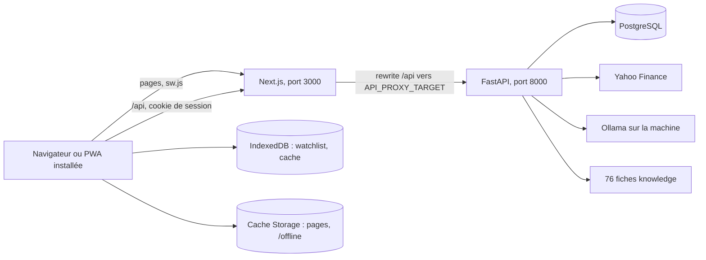

# MarketPulse — site (PWA Next.js)

Lecture de marché pour un projet universitaire : cours, Pulse Score, alertes, fiches pédagogiques et chat.
Les cours viennent de Yahoo Finance via l'API. Ce n'est pas un conseil en investissement.

- Ce dépôt : le site (Next.js 16, React 19, Tailwind 4, Serwist, IndexedDB).
- Dépôt voisin `finsight` : l'API FastAPI, PostgreSQL, les fiches et le chat. Son README décrit les routes et la sécurité.
- Version présentée : tag `v1.0-validation` dans les deux dépôts.

## Démarrage en une page

Prérequis : Node 20 ou plus, Docker Desktop lancé, ports 3000, 8000 et 5432 libres.

```powershell
# 1. API et base (dépôt finsight)
cd finsight
copy .env.example .env
docker compose up -d --build
# http://127.0.0.1:8000/health doit répondre {"status":"ok","service":"marketpulse"}

# 2. Site (ce dépôt)
cd ..\marketpulse
copy .env.example .env.local
npm ci
npm run build
npm start
```

Ouvrir http://localhost:3000.

- `npm run dev` sert pour développer, mais le service worker y est désactivé : la PWA (installation, hors ligne) se teste avec `npm run build` puis `npm start`.
- Après chaque `npm run build`, relancer `npm start`.
- Sans API, le bouton « Continuer en mode démo » de la page de connexion ouvre le site avec un jeu local étiqueté « Données de démonstration ».
- Optionnel : Ollama sur la machine (`ollama pull llama3.2:3b`) pour la reformulation du chat. Sans lui, le chat sert la réponse calculée en Python.

## Vérifier

```powershell
npm run check
```

Enchaîne `eslint`, `tsc --noEmit`, le test du Pulse Score (`scripts/pulse.test.ts`) et `next build --webpack`. Le build génère `public/sw.js` (ignoré par Git).

## Architecture



Le navigateur n'appelle que `/api` sur le site ; Next relaie vers l'API. Le cookie de session reste donc sur le même site (`HttpOnly`, `SameSite=Lax`).

## Variables

| Variable | Fichier | Défaut | Rôle |
| --- | --- | --- | --- |
| `NEXT_PUBLIC_API_URL` | `.env.local` | `/api` | Adresse appelée par le navigateur. Laisser `/api`. |
| `API_PROXY_TARGET` | `.env.local`, ou réglage Vercel | `http://127.0.0.1:8000` | Cible du rewrite `/api`. Sur Vercel : URL HTTPS publique de l'API. |

Les variables de l'API (base, session, e-mail, Ollama, push, Google) sont dans le README de `finsight`. Aucun secret n'est nécessaire côté site.

## Ce que la validation demande, et où c'est dans le code

| Exigence | Fichiers |
| --- | --- |
| PWA installable | `src/app/manifest.ts` (standalone, icônes 192 et 512, maskable), `src/components/InstallPrompt.tsx` |
| Hors ligne | `src/app/sw.ts` (Serwist : précache, `/api` en `NetworkOnly`, repli `/offline`), `src/lib/data.ts` (réseau, puis cache IndexedDB, puis jeu local), `src/components/OfflineBanner.tsx` |
| CRUD | Watchlist `src/app/watchlist/page.tsx` + `src/lib/db.ts` (IndexedDB) ; alertes `src/app/alerts/page.tsx` (API `/me/alerts`, repli local `src/lib/alertsLocal.ts`) ; conversations `src/app/chat/page.tsx` ; profil `src/app/profile/page.tsx` |
| Mobile d'abord | `src/components/AppShell.tsx` (onglets en bas sous `md`), `viewport` dans `src/app/layout.tsx` |
| Bonus IA | `src/app/chat/page.tsx`, `src/components/ChatDock.tsx` ; moteur dans `finsight/backend/app/chat_engine.py` |
| Hébergement Vercel | `vercel.json`, `docs/DEPLOY-VERCEL.md` |

Pages : `/dashboard`, `/markets`, `/asset/[symbol]`, `/watchlist`, `/alerts`, `/compare`, `/chat`, `/academy`, `/learn`, `/notifications`, `/profile`, `/status`, `/login`, `/register`, `/forgot-password`, `/reset-password`, `/onboarding`, `/offline`.

Le Pulse Score (`src/lib/pulse.ts`) pondère la position face aux moyennes mobiles (45 %), la stabilité (30 %) et le repli maximal (25 %). La probabilité du modèle n'y entre pas.

## Documents

- `docs/VALIDATION.md` : ce qui a été vérifié, avec les commandes.
- `docs/DEMO.md` : démonstration en 5 minutes et plans B.
- `docs/QUESTIONS_JURY.md` : 15 questions probables et où trouver la réponse dans le code.
- `docs/CHECKLIST_VEILLE.md` : à faire la veille et le matin.
- `docs/DEPLOY-VERCEL.md` : déploiement du site.
- `docs/PHASE-V-AUDIT.md` : audit précédent (historique).

## Limites connues

- **Le lien Vercel est une démonstration sans API.** https://marketpulse-zeta-jet.vercel.app sert les pages, le manifest et le service worker, mais `/api` y répond 404 : `API_PROXY_TARGET` n'y pointe vers aucune API publique. Seuls le mode démo, la watchlist locale et le hors ligne y fonctionnent. Le produit complet se montre en local.
- **L'API n'est déployée nulle part.** `finsight/render.yaml` n'a jamais été appliqué.
- **Notifications push non configurées** : pas de clés VAPID, donc les notifications restent dans l'application. L'envoi push réel n'a jamais été testé.
- **Connexion Google non testée** : le bouton n'apparaît que si les deux variables Google sont définies, et le flux n'a jamais été rejoué contre Google.
- **FinBERT désactivé** : le sentiment des titres d'actualité est toujours vide.
- **Modèle sans avantage prouvé** : 52,7 % de précision contre 52,9 % pour la règle « toujours hausse ». Il est affiché comme tel et n'entre pas dans le Pulse Score.
- **Six mois de cours** par actif (plage Yahoo `6mo`).
- **E-mail réel non configuré par défaut** : le code de connexion arrive dans Mailpit (http://localhost:8025) ou dans les logs de l'API. Recevoir le code dans une vraie boîte demande un compte d'envoi (`finsight/configurer-email.ps1`), jamais testé de bout en bout.
- **Chat avec Ollama** : sur la machine de développement, la reformulation ne tient pas dans le délai de 30 secondes ; c'est la réponse Python qui est servie.
- **Mode démo** : les chiffres affichés viennent de `src/mock/data.json` et sont étiquetés comme tels ; les alertes créées sans API restent sur l'appareil.
- **Installation sur un vrai téléphone** : contrôlée sur le build et sur Chrome, pas sur un appareil physique.
- Un avertissement eslint connu (`react-hooks/exhaustive-deps` dans `src/hooks/useResource.ts`), sans erreur.
- **Qualité outillée** : la porte qualité SonarCloud est en échec sur les deux dépôts et `npm audit` signale 7 avis dans les dépendances de production. Détail dans `docs/VALIDATION.md`.
